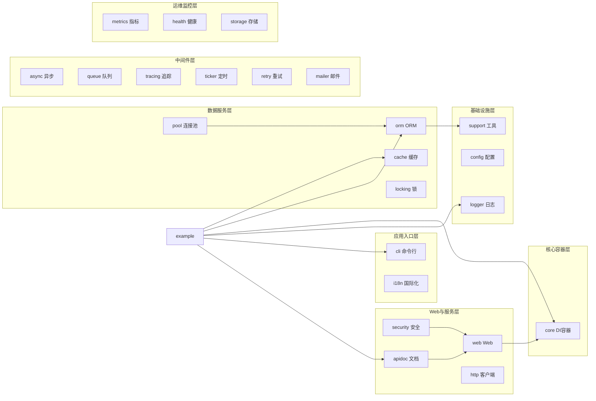
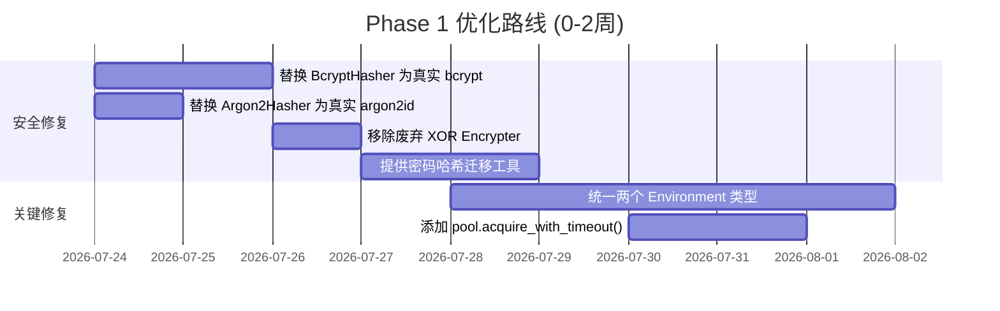
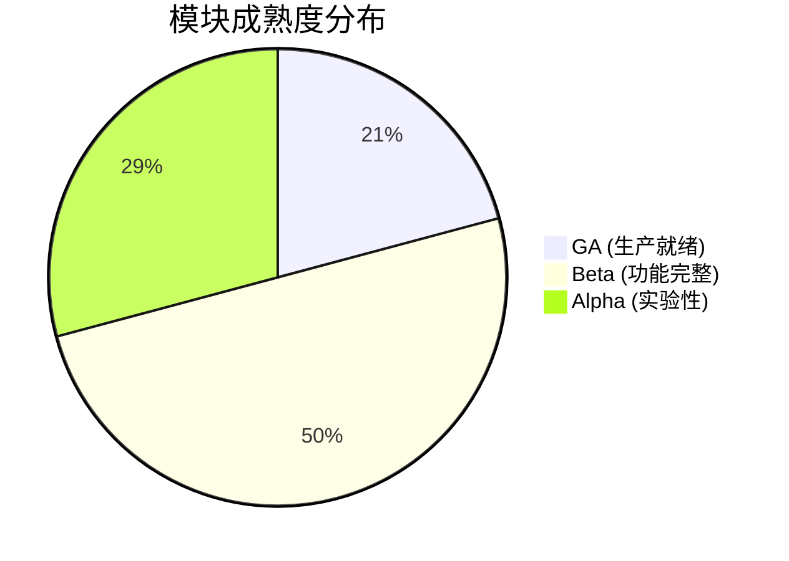

# Photon 框架 — 结构化代码分析报告

> **历史快照**：本文是 2026-07-23 的代码分析报告，记录当时状态与建议，不代表当前实现。
> 当前架构以 [README.md](README.md) 和 [ARCHITECTURE.md](ARCHITECTURE.md) 为准。

> 生成日期: 2026-07-23 | 分析范围: 24 个模块, 约 200+ 源文件
>
> 本报告从**功能确认、代码审查、模块分析、优化建议**四个维度对 Photon 框架进行全面分析。

---

## 目录

1. [执行摘要](#1-执行摘要)
2. [模块全景矩阵](#2-模块全景矩阵)
3. [核心模块逐项分析](#3-核心模块逐项分析)
   - [3.1 core — DI 容器/生命周期/注解引擎](#31-core)
   - [3.2 web — HTTP 路由/中间件链/控制器](#32-web)
   - [3.3 security — JWT/RBAC/CSRF/密码哈希](#33-security)
   - [3.4 orm — ORM 层/仓库模式/JpaRepository](#34-orm)
   - [3.5 cache — 缓存抽象 (memory/Redis)](#35-cache)
   - [3.6 config — 配置源/属性绑定/Environment](#36-config)
   - [3.7 pool — 通用对象池/数据库连接池](#37-pool)
   - [3.8 locking — 本地互斥锁/DistributedLock](#38-locking)
   - [3.9 logger — 结构化日志](#39-logger)
   - [3.10 queue — 消息队列抽象](#310-queue)
   - [3.11 async — 异步任务执行器](#311-async)
   - [3.12 tracing — 分布式追踪](#312-tracing)
   - [3.13 ticker — Timer/Ticker/Cron 调度](#313-ticker)
   - [3.14 retry — 指数退避重试](#314-retry)
   - [3.15 mailer — SMTP 邮件](#315-mailer)
   - [3.16 metrics — 应用指标](#316-metrics)
   - [3.17 health — 健康检查](#317-health)
   - [3.18 storage — 文件/对象存储](#318-storage)
   - [3.19 i18n — 国际化](#319-i18n)
   - [3.20 http — RestTemplate HTTP 客户端](#320-http)
   - [3.21 cli — CLI 命令框架](#321-cli)
   - [3.22 support — 集合/字符串/分页工具](#322-support)
   - [3.23 apidoc — API 文档生成器](#323-apidoc)
   - [3.24 example — 示例应用](#324-example)
4. [跨模块问题汇总](#4-跨模块问题汇总)
5. [问题严重性分级](#5-问题严重性分级)
6. [优化路线图](#6-优化路线图)
7. [附录](#7-附录)

---

## 1. 执行摘要

### 1.1 框架总体评分

| 维度 | 评分 (1-5) | 说明 |
|------|-----------|------|
| **功能完整度** | ★★★★☆ (4/5) | 覆盖 DI/Web/ORM/缓存/安全/消息等企业级场景，对标 Spring Boot 生态 |
| **代码质量** | ★★★☆☆ (3/5) | 架构分层清晰，但存在 unsafe 滥用、代码重复、双重实现等问题 |
| **安全性** | ★★☆☆☆ (2/5) | JWT/RBAC/CSRF 设计完善，但密码哈希为虚假实现(PBKDF2 冒充 Bcrypt/Argon2) |
| **可维护性** | ★★★☆☆ (3/5) | 文档极其丰富，但模块间存在双重实现，增加维护负担 |
| **生产就绪度** | ★★★☆☆ (3/5) | 核心模块可投入生产，但多个模块存在 stub 实现，缺乏关键后端 |

**综合评分: 3.0/5 — 架构设计优秀，实现质量中等，安全问题需立即修复。**

### 1.2 Top-5 严重问题

| # | 问题 | 严重性 | 影响范围 |
|---|------|--------|---------|
| 1 | **BcryptHasher/Argon2Hasher 均为 PBKDF2-SHA256 伪实现** | P0-Critical | 所有使用 security 模块的应用密码不安全 |
| 2 | **core.Environment 与 config.Environment 同名不同类型** | P1-High | 用户混淆，API 不一致 |
| 3 | **JpaRepository 将所有字段值转为 string 执行 SQL** | P1-High | 类型安全丢失，数值比较/排序出错 |
| 4 | **core 模块 unsafe 指针 200+ 处，缺乏编译期安全保证** | P1-High | 内存安全风险，调试困难 |
| 5 | **logger 存在 Logger/ChannelLogger 两套独立系统** | P1-High | 功能重复，用户选择困惑 |

### 1.3 改进优先级概览

```
P0 (立即, 0-2周):  修复密码哈希 → 替换为真实 bcrypt/argon2 实现
P1 (短期, 1-3月):  统一 Environment/Logger/Pagination → 减少 unsafe → 修复 JPA 类型安全
P2 (中期, 3-6月):  补齐 S3/DistributedLock/Queue Driver/Tracing Exporter
P3 (长期, 6-12月): API 简化、文档完善、性能优化、测试覆盖率提升
```

---

## 2. 模块全景矩阵

### 2.1 模块依赖拓扑图



> **关键特征**: 模块间**无循环依赖**，大部分模块仅依赖 V 标准库，耦合度极低。核心模块间通过接口解耦，用户可在引导层自由组合。

### 2.2 模块成熟度分布

| 成熟度 | 模块 | 数量 |
|--------|------|------|
| **GA** (生产就绪) | retry, mailer, health, cli, support | 5 |
| **Beta** (功能完整) | core, web, orm, cache, security, logger, async, queue, ticker, metrics, http, i18n | 12 |
| **Alpha** (实验性) | config, pool, locking, tracing, storage, apidoc, example | 7 |

### 2.3 模块统计总表

| # | 模块 | 文件数 | 估行数 | 关键风险 |
|---|------|--------|--------|---------|
| 1 | core | 43 | ~6,500 | unsafe 200+处, 文件过大 |
| 2 | web | 79 | ~4,000 | 路径参数已废弃, veb 强耦合 |
| 3 | security | 29 | ~5,200 | **密码哈希伪实现** |
| 4 | orm | 36 | ~3,000 | JPA 字符串化, callback 冗长 |
| 5 | cache | 13 | ~1,200 | 缺少序列化层, 无监控 |
| 6 | config | 7 | ~500 | 与 core.Environment 重复 |
| 7 | pool | 6 | ~600 | 无阻塞获取, 无连接验证间隔 |
| 8 | locking | 5 | ~400 | 无分布式锁实现 |
| 9 | logger | 6 | ~1,300 | Logger/ChannelLogger 双系统 |
| 10 | queue | 8 | ~1,100 | 仅内存驱动, 无持久化 |
| 11 | async | 4 | ~300 | 无 Future/Promise 返回值 |
| 12 | tracing | 5 | ~650 | 无 OTel/Zipkin 导出器 |
| 13 | ticker | 9 | ~1,200 | Cron 解析器边界问题 |
| 14 | retry | 2 | ~330 | 错误类型匹配不精确 |
| 15 | mailer | 2 | ~630 | 无 |
| 16 | metrics | 2 | ~530 | 无 Histogram, 无 PushGateway |
| 17 | health | 2 | ~405 | 无 |
| 18 | storage | 6 | ~900 | S3 为 stub 实现 |
| 19 | i18n | 2 | ~230 | 仅 3 种语言, 无 Accept-Language |
| 20 | http | 4 | ~700 | SSL/Proxy 预留未实现 |
| 21 | cli | 13 | ~2,200 | 无 |
| 22 | support | 15 | ~2,300 | 两套分页系统重叠 |
| 23 | apidoc | 8 | ~900 | OpenAPI 导出不完整 |
| 24 | example | 19 | ~2,200 | 自定义 JWT 与 security 重复 |

---

## 3. 核心模块逐项分析

### 3.1 core

#### 3.1.1 功能确认

core 模块是 Photon 框架的心脏，提供企业级 IoC 容器和完整的 Spring 风格生命周期管理。

**核心功能清单**:
- **IoC 容器**: `Container` — 中心化组件注册与解析，支持 singleton/prototype/request 三种作用域
- **依赖注入**: `@[autowired]` 字段注入 + `@[qualifier('name')]` 限定符 + `@[value('key:default')]` 属性注入
- **Bean 生命周期**: 实例化 → 属性填充 → `@[post_construct]` → 就绪 → `@[pre_destroy]` → 销毁
- **ApplicationContext**: 统一应用上下文，组合 Container + EventBus + LifecycleManager + Environment
- **BeanPostProcessor**: 完整的 Spring 风格后处理器链 (BeanPostProcessor → BeanFactoryPostProcessor → BeanDefinitionRegistryPostProcessor)
- **事件系统**: `EventBus` 带分片锁，支持异步分发、优先级监听、事务阶段事件
- **条件装配**: 8 种 `@[conditional_on_*]` 注解，对标 Spring Boot 自动配置
- **注解扫描**: 编译期 `$for` 扫描 `@[component]`/`@[service]`/`@[repository]`/`@[controller]`/`@[configuration]`
- **智能生命周期**: `SmartLifecycle` 按阶段 (phase) 有序启动/停止
- **循环依赖检测**: DFS 算法编译期检测循环依赖并报错

**业务数据流**:
```
扫描阶段:  源码 @[component] → comptime $for 扫描 → BeanDefinition 注册
启动阶段:  refresh() → BeanFactoryPostProcessor → 实例化(拓扑排序) → @post_construct → SmartLifecycle.start()
运行阶段:  resolve() → 查单例缓存 → 查 FactoryBean → 创建新实例(prototype) → 注入 autowired 字段
关闭阶段:  shutdown() → SmartLifecycle.stop(reverse) → @pre_destroy → 清空缓存
```

#### 3.1.2 代码质量

**优点**:
- Spring 接口层次完整镜像 (`BeanFactory` → `ListableBeanFactory` → `HierarchicalBeanFactory` → `AutowireCapableBeanFactory`)
- 锁性能优化策略分层：容器级 `RwMutex`、事件级 `ShardedRwMutex`、解析缓存无锁读取
- 双检查锁模式（先读锁快速路径，再写锁慢速路径 + 二次确认）正确实现
- 拓扑排序 (Kahn 算法) 控制 bean 实例化顺序

**问题清单**:

| # | 问题 | 位置 | 严重性 |
|---|------|------|--------|
| 1 | `core.v` 约 2000 行，`application_context.v` 约 1853 行，违反单一职责 | `core/core.v`, `core/application_context.v` | P2 |
| 2 | `BeanDefinition` 混合运行时字段与扫描时字段 (`component_type`, `value_bindings`, `tags`) | `core/core.v:138` | P3 |
| 3 | `scan_and_register` 与 `scan_component_info` 扫描逻辑重复 | `core/scanner.v:772`, `core/scanner.v:917` | P2 |
| 4 | `generate_request_id()` 注释声称 "UUID v4" 但实际使用时间戳 LCG | `web/middleware.v:288` | P2 |
| 5 | 生命周期注解拼写 `@[post_construct]`/`@[pre_destroy]`(两个独立单词), 与 Spring `@PostConstruct` 风格不一致 | `core/scanner.v` | P3 |
| 6 | 大量 `unsafe { &SomeInterface(c) }` 类型转换模式, core 模块约 200+ 处 | 全模块 | P1 |
| 7 | `unsafe { nil }` 作为函数指针默认值，运行时 `isnil()` 检查是事后防御 | 多处 | P2 |

#### 3.1.3 模块依赖

- **上游**: 无 (仅依赖 V 标准库 `sync`, `time`, `ticker`)
- **下游**: 被 `web`, `example` 模块引用

#### 3.1.4 风险评估

| 风险类型 | 风险描述 | 可能性 | 影响 |
|---------|---------|--------|------|
| 内存安全 | `unsafe` 指针转换不当可能导致段错误 | 中 | 高 |
| 并发安全 | 容器单 `RwMutex` 在高并发 resolve 时成为瓶颈 | 低 | 中 |
| 循环依赖 | 仅检测编译期已知类型, 运行期动态注册可能绕过 | 低 | 中 |

#### 3.1.5 成熟度评定: **Beta (75%)**

核心 DI 功能完善, 事件系统成熟, 条件装配完整。需改进: unsafe 收窄、文件拆分、扫描逻辑去重。

#### 3.1.6 优化建议

| 优先级 | 建议 | 说明 |
|--------|------|------|
| 短期 | 拆分 `core.v` | 将 Container/BeanDefinition/解析逻辑分离到独立文件 |
| 短期 | 统一 `scan_and_register` 与 `scan_component_info` | 提取公共扫描逻辑为内部函数 |
| 中期 | 减少 unsafe 使用 | 用 V 的接口类型系统替代 unsafe 转换 |
| 中期 | 为 `BeanDefinition` 引入 `ScannedMetadata` 嵌入结构体 | 分离扫描时元数据与运行时 DI 字段 |
| 长期 | 实现三级缓存解决 setter 循环依赖 | 对标 Spring 三级缓存机制 |

---

### 3.2 web

#### 3.2.1 功能确认

**核心功能清单**:
- **路由注册**: `RouteRegistry` 支持 GET/POST/PUT/DELETE/PATCH, 路由组, 主机过滤
- **控制器模式**: `Controller` 接口 + `BaseController` 便捷响应方法 (ok/created/bad_request/not_found/...)
- **中间件链**: 前置中间件 → 路由中间件 → 处理器 → 路由后置 → 全局后置, 支持短路
- **静态文件服务**: 支持预压缩文件 (.gz/.zst 零拷贝), 即时压缩+磁盘缓存, Markdown 内容协商
- **内置中间件**: request_id, cors, auth, timing, compression (gzip/zstd), decode_gzip/decode_zstd
- **响应压缩**: 自动 gzip/zstd 压缩, 支持 Accept-Encoding 协商
- **请求体解压**: 自动解压 gzip/zstd 请求体

**请求数据流**:
```
HTTP 请求 → veb.before_request() → handle_request(ctx_ptr)
  → 静态资源检查(Markdown协商) → 静态文件解析(预压缩→即时压缩→原始)
  → router.dispatch_with_chain()
    → 全局前置中间件 → 路由前置中间件 → Handler(闭包)
    → 路由后置中间件(压缩/安全头) → 全局后置中间件
  → 返回 veb.Result
```

#### 3.2.2 代码质量

**优点**:
- Web 层与 core DI 容器完全解耦，可独立使用 — 优秀的架构设计
- 中间件链设计灵活，支持全局/路由级/前置/后置四层控制
- 静态文件压缩缓存策略完善（零拷贝预压缩 + 即时压缩 + 磁盘缓存）
- `MiddlewareContext` 的 `reset()` 保留 `_global_` 前缀数据，设计精巧

**问题清单**:

| # | 问题 | 位置 | 严重性 |
|---|------|------|--------|
| 1 | `handle_request` 通过 `voidptr` + `unsafe` 转换 veb.Context, 脆弱 | `web/web.v:165` | P1 |
| 2 | `get_path_param()` 已废弃但未移除, 返回空字符串 | `web/web.v` | P3 |
| 3 | `enable_markdown_negotiation` 手动复制 `StaticCompressionConfig` 所有字段, 新增字段时易遗漏 | `web/web.v:344` | P2 |
| 4 | MIME 类型在 `veb_mime_type` 函数中硬编码, 未复用 veb 内置常量 | `web/web.v:241` | P3 |
| 5 | 路径参数注释说"应通过 params 字典获取", 但 params 字典的实现不清晰 | `web/router.v:266` | P2 |

#### 3.2.3 模块依赖

- **上游**: 无 Photon 内部依赖, 仅依赖 `veb`, `os`, `net.http`, `json`, `time`, `compress.gzip`, `compress.zstd`
- **下游**: 被 `security` (SecurityFilterChain 集成), `apidoc`, `example` 引用

#### 3.2.4 风险评估

| 风险类型 | 风险描述 |
|---------|---------|
| 耦合风险 | 深度绑定 veb 框架, veb API 变更会影响 web 模块 |
| 内存安全 | `unsafe { &veb.Context(ctx_ptr) }` 依赖嵌入结构体布局约定 |

#### 3.2.5 成熟度评定: **Beta (80%)**

功能完整, 中间件链设计优秀, 静态文件服务生产可用。需改进: 减少 veb 耦合, 完善路径参数支持。

#### 3.2.6 优化建议

| 优先级 | 建议 |
|--------|------|
| 短期 | 用构建函数替代 `enable_markdown_negotiation` 中的手动字段复制 |
| 短期 | 移除已废弃的 `get_path_param()` 方法 |
| 中期 | 抽象 veb 依赖为内部接口层, 便于切换 Web 框架 |
| 长期 | 实现完整的路径参数支持 (`/users/:id`) |

---

### 3.3 security

#### 3.3.1 功能确认

**核心功能清单**:
- **认证**: `AuthenticationManager` + `AuthenticationProvider` 策略链模式
  - `JwtAuthenticationProvider` — Bearer/JWT 令牌认证
  - `UsernamePasswordAuthenticationProvider` — 用户名/密码认证
- **JWT**: `JwtManager` — HMAC-SHA256 签名, access/refresh token 双令牌
- **密码编码**: `PasswordEncoder` 接口 + `DelegatingPasswordEncoder` (Spring Security 风格 `{id}hash` 格式)
  - `BCryptPasswordEncoder`, `Argon2PasswordEncoder`, `FnvPasswordEncoder` (迁移用)
- **RBAC**: `RoleHierarchy` (层级角色继承), `AccessDecisionManager`
- **CSRF**: `CsrfManager` — Double-Submit Cookie 模式
- **安全注解**: `@[secured]`, `@[roles_allowed]`, `@[permit_all]`, `@[deny_all]`, `@[pre_authorize]`, `@[post_authorize]`
- **OAuth**: `OAuthContext` — 授权码流令牌交换 + 构建授权 URL
- **真实加密**: `AesCipher` — AES-256-CBC + HMAC-SHA256 认证加密
- **Web 集成**: `SecurityFilterChain` — 六步过滤 (CSRF → JWT → RBAC)

#### 3.3.2 代码质量

**严重问题 — P0 安全漏洞**:

> ⚠️ **BcryptHasher 和 Argon2Hasher 均为虚假实现！**
>
> `security/hashing.v:113-128` 中的 `hash_string()` 函数统一使用 `pbkdf2.key(..., sha256.new())` 进行密钥派生。无论是 `BcryptHasher.make()` 还是 `Argon2Hasher.make()`，实际都调用同一个 PBKDF2-SHA256 实现，仅输出格式伪装成 `$2y$` 或 `$argon2id$` 前缀。
>
> **影响**: 如果用户将来切换到真实的 bcrypt/argon2 库，所有已存储的密码哈希将无法验证，导致全部用户需要重置密码。

```v
// security/hashing.v:111-128 — 两个 Hasher 共用此函数
fn hash_string(password string, salt string, extra u64) string {
    // 实际使用 PBKDF2-SHA256, 而非 bcrypt 或 argon2
    derived := pbkdf2.key(password.bytes(), salt.bytes(), safe_iterations, 32, sha256.new()) or { []u8{} }
    return derived.map(it.hex()).join('')
}
```

**其他问题**:

| # | 问题 | 位置 | 严重性 |
|---|------|------|--------|
| 1 | `BcryptHasher`/`Argon2Hasher` 使用 PBKDF2-SHA256 非真实 bcrypt/argon2 | `security/hashing.v:18-128` | **P0** |
| 2 | `encryption.v` 中 `Encrypter` 使用 XOR 密码(0xAA)且已废弃但仍存在 | `security/encryption.v` | P1 |
| 3 | `SecurityContextHolder` 全局状态在多线程环境缺乏说明 | `security/context.v` | P2 |
| 4 | `filter.v` 中 `metadata()` 方法声明在 `mut` 方法组但未修改状态 | `security/filter.v` | P3 |

#### 3.3.3 模块依赖

- **上游**: 依赖 `veb` (仅在 `filter.v` 中), V 标准加密库 (`crypto.aes`, `crypto.hmac`, `crypto.sha256`, `crypto.sha512`, `crypto.pbkdf2`)
- **下游**: 被 `example` 引用

#### 3.3.4 风险评估

| 风险类型 | 风险描述 | 可能性 | 影响 |
|---------|---------|--------|------|
| **密码安全** | 虚假 bcrypt/argon2 实现, 迁移真实库后全部密码失效 | 确定 | **极高** |
| 密钥管理 | JWT 签名密钥需用户自行安全管理 | 中 | 高 |
| XOR 误用 | 废弃的 XOR Encrypter 可能被用户误用 | 低 | 高 |

#### 3.3.5 成熟度评定: **Beta (70%) — 降级原因: 密码哈希为虚假实现**

认证授权架构设计完善 (Spring Security 风格), 安全注解系统完整。**密码哈希必须重写为真实 bcrypt/argon2 才能达到生产标准。**

#### 3.3.6 优化建议

| 优先级 | 建议 | 说明 |
|--------|------|------|
| **立即** | **替换 BcryptHasher 为真实 bcrypt 实现** | 使用 V 的 `crypto.bcrypt` 标准库或引入可信第三方库 |
| **立即** | **替换 Argon2Hasher 为真实 argon2id 实现** | 使用 V 的 `crypto.argon2` 或 C 绑定 |
| 短期 | 移除或彻底隔离 `encryption.v` 中的 XOR Encrypter | 避免用户误用 |
| 短期 | 提供密码哈希迁移工具 | 帮助从旧格式迁移到真实 bcrypt/argon2 |
| 中期 | 添加 `SecurityContextHolder` 的线程安全文档 | 明确多线程使用约束 |

---

### 3.4 orm

#### 3.4.1 功能确认

**核心功能清单**:
- **连接管理**: `OrmManager` — 多连接路由, 支持关闭回调, 默认连接切换
- **实体映射**: `BaseEntity` (id/created_at/updated_at/version) + 8 个生命周期钩子接口
- **仓库模式**: `Repository[T]` 接口 + `BaseRepository[T]` 实现 + `DerivedRepository[T]` 派生查询 + `JpaRepository[T]` 编译期 SQL
- **事务管理**: `TransactionManager` — 7 种传播行为 + 5 种隔离级别 + 超时/只读/回滚规则
- **关系映射**: `HasMany[T]`/`BelongsTo[T]`/`ManyToMany[T]`/`HasOne[T]` + `RelationLoader`
- **数据库迁移**: `MigrationManager` + `Schema` Builder (Laravel/Flyway 风格)
- **规格模式**: `Specification[T]` + `AndSpecification`/`OrSpecification`/`NotSpecification` 组合器
- **乐观锁**: version 字段 + affected_rows 检测
- **DTO 验证**: 6 种验证注解 (`@[required]`, `@[min]`, `@[max]`, `@[email]` 等)
- **软删除**: `SoftDeletableEntity`

**核心设计模式 — 回调注入**:
由于 Photon ORM 与 V 标准 ORM 模块同名冲突, 所有 CRUD 操作通过回调函数类型注入:
```v
// 用户在自己的模块中同时导入 orm 和 photon.orm
// 将 V 的 QueryBuilder 注入 photon 的回调
repo := BaseRepository[User]{
    find_all: fn [db] (query string) []User { ... },  // 用户提供 V ORM 执行逻辑
    insert: fn [db] (entity User) i64 { ... },
    // ... 共需 7-11 个回调
}
```

#### 3.4.2 代码质量

**优点**:
- 文档质量极高, 每个文件头部有详细的架构图
- SQL 注入防护到位 (参数化查询 + 标识符白名单验证)
- 事务传播机制完整 (对标 Spring `@Transactional`)
- 乐观锁实现正确 (version 字段 + affected_rows 检测)
- DTO 验证系统完整

**问题清单**:

| # | 问题 | 位置 | 严重性 |
|---|------|------|--------|
| 1 | **`JpaRepository.save()/update()` 将所有字段值转为 `string` 再执行 SQL** | `orm/repository.v` | **P1** |
| 2 | `OrmAdapter.wrap_save()` 逻辑在 `BaseRepository.save()` 中重复实现 | `orm/adapter.v`, `orm/repository.v` | P2 |
| 3 | 每个 `BaseRepository` 需要 7 个回调, `DerivedRepository` 需要 11 个 — 用户配置负担重 | `orm/repository.v` | P3 |
| 4 | `MigrationManager` Schema Builder 只支持基本 DDL, ALTER TABLE/索引不完整 | `orm/migration.v` | P2 |
| 5 | 大量 `unsafe { nil }` 作为函数指针默认值 | 多处 | P2 |
| 6 | 乐观锁仅 `JpaRepository` 支持, `BaseRepository` 不支持 | `orm/repository.v` | P2 |

**JPA 字符串化问题详解**:
```v
// JpaRepository 在生成 SQL 时将字段值转为字符串, 丢失类型信息
// 例如: int 类型的 age 字段被转为 "25", 导致 SQL 中的数值比较变为字符串比较
// 影响: 数值排序错误 (字符串 "9" > "10"), 布尔字段无法正确查询
```

#### 3.4.3 模块依赖

- **上游**: 依赖 `support` (snake_case 转换, Page/PageRequest/Sort)
- **下游**: 被 `example`, `pool` 引用

#### 3.4.4 风险评估

| 风险类型 | 风险描述 |
|---------|---------|
| 类型安全 | JpaRepository 全字符串化导致数值查询/排序错误 |
| 配置复杂度 | 7-11 个回调注入, 新手门槛高 |
| 数据一致 | Schema Builder 不完整, 生产迁移受限 |

#### 3.4.5 成熟度评定: **Beta (75%)**

核心 CRUD 路径完善, 事务管理成熟。**JPA 字符串化是生产环境的定时炸弹。**

#### 3.4.6 优化建议

| 优先级 | 建议 |
|--------|------|
| 短期 | 修复 JpaRepository 的类型安全, 使用参数化类型而非字符串拼接 |
| 短期 | 统一 `wrap_save` 与 `save` 的重复逻辑 |
| 中期 | 简化回调注入, 提供 Builder 模式或默认回调模板 |
| 中期 | 完善 MigrationManager 的 ALTER TABLE/索引支持 |
| 长期 | 将乐观锁支持扩展到 BaseRepository |

---

### 3.5 cache

#### 3.5.1 功能确认

**核心功能清单**:
- **缓存抽象**: `Cache` 接口 (get/set/delete/has/clear/keys/size)
- **内存缓存**: `MemoryCache` — LRU 淘汰 + 后台 GC, 高性能并发设计
- **Redis 缓存**: `RedisStore` — 基于第三方 `xiusin.vredis`
- **Spring Cache 适配**: `CacheManager`/`NamedCache` 对标 Spring
- **缓存注解**: `@[cacheable]`/`@[cache_evict]`/`@[cache_put]` + SpEL 条件表达式
- **防缓存击穿**: `Singleflight` — call deduplication (Go 风格)
- **缓存注册表**: `CacheRegistry` — 命名缓存管理 + 默认缓存

**并发设计亮点**:
- 读写锁分离 (读操作用 rlock, 写操作用 @lock)
- hit_count 独立 mutex 避免读路径写操作
- TOCTOU 修复 (过期检查: 释放读锁 → 获取写锁 → 重新检查)
- two-pass 批量过期淘汰

#### 3.5.2 代码质量

**优点**:
- MemoryCache 并发设计优秀, 可作教学案例
- Singleflight 正确实现 call deduplication
- 条件表达式引擎支持 `and`/`or`/`==`/`!=` 及 `#result`/`#param.name`

**问题清单**:

| # | 问题 | 位置 | 严重性 |
|---|------|------|--------|
| 1 | `get_or_load` 仅支持默认缓存, 不支持命名缓存 | `cache/annotation.v` | P2 |
| 2 | 缓存注解需要编译期代码生成支持, 当前仅运行时 `CacheableInterceptor.get_or_compute()` 可用 | `cache/annotation.v` | P2 |
| 3 | `Cache` 接口仅支持 `string` 值, 无序列化层 | `cache/cache.v` | P2 |
| 4 | 缺少 CachePut/CacheEvict 前后的监听钩子 | — | P3 |
| 5 | Redis 缓存依赖第三方 vredis, 稳定性需验证 | `cache/redis_cache.v` | P2 |

#### 3.5.3 模块依赖

- **上游**: 依赖 `xiusin.vredis` (外部 Redis 客户端)
- **下游**: 被 `example` 引用

#### 3.5.4 成熟度评定: **Beta (65%)**

内存缓存生产可用, Redis 缓存需验证。缺少: 序列化层、缓存事件、监控集成、Memcached 后端。

#### 3.5.5 优化建议

| 优先级 | 建议 |
|--------|------|
| 短期 | 为 `get_or_load` 添加命名缓存支持 |
| 中期 | 添加缓存序列化层 (支持 JSON/MessagePack 等) |
| 中期 | 添加缓存事件钩子 (CachePut/CacheEvict 前后) |
| 长期 | 添加缓存监控/metrics 集成 |

---

### 3.6 config

#### 3.6.1 功能确认

**核心功能清单**:
- **配置源**: `FileConfigSource` (JSON/properties), `EnvConfigSource` (环境变量), `MapConfigSource` (内存默认值)
- **属性绑定**: `PropertyBinder` — 编译期 `$for` 绑定 struct 字段, 对标 `@ConfigurationProperties`
- **占位符解析**: `${key:default}` 格式, 支持嵌套占位符和循环引用检测
- **配置聚合**: `Config` 结构体 + `ConfigSource` 接口, 支持多源合并

#### 3.6.2 代码质量

**严重问题 — P1 双重 Environment**:

> ⚠️ **存在两个同名的 `Environment` 类型!**
>
> - `core/environment.v:95` 定义 `core.Environment` — `ApplicationContext` 使用的版本
> - `config/environment.v:19` 定义 `config.Environment` — `PropertyBinder` 使用的版本
>
> 两者功能相似 (get_active_profiles/contains_property/has_property), 但类型不同, 无法互换。

**其他问题**:

| # | 问题 | 位置 | 严重性 |
|---|------|------|--------|
| 1 | core.Environment 与 config.Environment 同名不同实现 | `core/environment.v:95`, `config/environment.v:19` | **P1** |
| 2 | `extract_value_expr_full()` 与 `extract_value_expr()` 在 config 和 core 中独立实现 | `config/property.v`, `core/scanner.v` | P2 |
| 3 | `Config` 与 `core.Environment` 存在属性获取职责重叠 | — | P2 |

#### 3.6.3 模块依赖

- **上游**: 无 Photon 内部依赖
- **下游**: 被 `core` 内部引用 (但 core 使用自己的 `Environment`)

#### 3.6.4 成熟度评定: **Alpha (50%)**

基本功能可用但存在严重的双重实现问题, 需要统一。

#### 3.6.5 优化建议

| 优先级 | 建议 |
|--------|------|
| **短期** | **统一 core.Environment 和 config.Environment** — 建议 config 模块废弃自己的 Environment, 改为依赖 core 的 |
| 短期 | 合并重复的 `extract_value_expr` 实现 |
| 中期 | 添加 `@ConfigurationProperties` 验证 (JSR-303 风格) |

---

### 3.7 pool

#### 3.7.1 功能确认

**核心功能清单**:
- **通用对象池**: `Pool<T>` — min/max size, idle timeout, max lifetime, 后台 GC
- **工厂模式**: `Factory` 接口 (create/validate/destroy)
- **RAII 守卫**: `PooledGuard<T>` + `with_acquired<T>()` 自动资源释放
- **数据库连接池**: `DbPool` — 封装 Pool + DriverType
- **池统计**: `PoolStats` — active/idle/total/wait 计数

#### 3.7.2 代码质量

**优点**:
- RAII 模式贯穿整个模块, 零心智负担
- 后台 GC 协程优雅停止 (stop_gc channel + WaitGroup)
- `acquire()` 优先复用空闲对象 + 容量检查

**问题清单**:

| # | 问题 | 位置 | 严重性 |
|---|------|------|--------|
| 1 | `acquire()` 池满时直接返回错误, 不支持阻塞等待 | `pool/pool.v` | P1 |
| 2 | 每次 acquire 都调用 `factory.is_valid()`, 无验证间隔控制 | `pool/pool.v` | P2 |
| 3 | `DbPool` 仅薄包装 Pool + DriverType, 未提供数据库 ping 查询 | `pool/db_pool.v` | P2 |
| 4 | `initialize()` 创建 min_size 对象但无渐进式预热 | `pool/pool.v` | P3 |
| 5 | `db_pool_id_counter` 全局变量并发安全但可改为局部 | `pool/db_pool.v` | P3 |

#### 3.7.3 成熟度评定: **Beta (70%)**

核心池机制完善, 需添加阻塞获取和数据库专用健康检查。

#### 3.7.4 优化建议

| 优先级 | 建议 |
|--------|------|
| 短期 | 添加 `acquire_with_timeout()` 阻塞等待接口 |
| 中期 | 添加连接验证间隔配置 (避免每次 acquire 都 ping) |
| 中期 | 为 DbPool 添加数据库专用健康检查 (ping query) |

---

### 3.8 locking

#### 3.8.1 功能确认

**核心功能清单**:
- **本地互斥锁**: `LocalMutex` — 基于 buffered channel (cap:1) 实现, OS 级 goroutine parking
- **分布式锁接口**: `DistributedLock` (acquire/release/renew/is_locked)
- **锁管理器**: `LockManager` — 统一本地/分布式锁访问, 引用计数管理
- **RAII 守卫**: `LockGuard` + `with_lock()` 零心智负担 API

**设计亮点**:
- `try_lock/timeout` 使用指数退避 (100μs → 200μs → ... → 1ms)
- `ref_counts` 机制防止 lock/unlock 竞态造成内存泄漏
- 后台 GC 清理 ref_count==0 的锁条目

#### 3.8.2 代码质量

**问题清单**:

| # | 问题 | 位置 | 严重性 |
|---|------|------|--------|
| 1 | **`DistributedLock` 仅有接口定义, 无具体实现** (无 Redis/Etcd/Zookeeper) | `locking/lock.v` | **P1** |
| 2 | `renew()`/`is_locked()` 在 `DistributedLock` 接口定义但 `LockManager` 未暴露 | `locking/lock.v` | P2 |
| 3 | `LockManager` 的 `ref_counts` 和 `local_locks` 存在弱一致性风险 | `locking/lock.v` | P2 |

#### 3.8.3 成熟度评定: **Alpha (40%)**

本地锁生产可用。分布式锁仅有接口定义, 无任何后端实现, 严重限制生产使用。

#### 3.8.4 优化建议

| 优先级 | 建议 |
|--------|------|
| **短期** | **实现 Redis 分布式锁** — 使用 SETNX + Lua 脚本续期 |
| 中期 | 在 LockManager 中暴露 `renew()`/`is_locked()` |
| 中期 | 添加 Etcd/Consul 分布式锁实现 |

---

### 3.9 logger

#### 3.9.1 功能确认

**核心功能清单**:
- **日志级别**: trace/debug/info/warn/error/fatal 六层
- **结构化日志**: JSONEncoder 输出 ELK/Loki 兼容格式
- **多输出**: ConsoleEncoder (彩色) + FileChannel + SyslogChannel
- **MDC 上下文**: 请求级结构化字段, Copy-On-Write 不可变复制
- **LoggerFactory**: DI 容器集成 (SLF4J 风格)
- **敏感数据遮蔽**: 自动脱敏密码/Token

#### 3.9.2 代码质量

**严重问题 — P1 双日志系统**:

> ⚠️ **Logger 与 ChannelLogger 是两套独立的日志系统, 功能大量重叠。**
>
> 两者都有 Level、上下文、配置格式化输出, 但互不兼容。

**其他问题**:

| # | 问题 | 位置 | 严重性 |
|---|------|------|--------|
| 1 | Logger 与 ChannelLogger 功能重复, 两套独立系统 | `logger/` | **P1** |
| 2 | `set_colored()` 总是新建 ConsoleEncoder 丢弃旧 encoder | `logger/` | P3 |
| 3 | `*f()` 格式化方法仅支持单个 `{}` 占位符, 函数名暗示 variadic | `logger/` | P3 |

#### 3.9.3 成熟度评定: **Beta (70%)**

结构化日志功能完善, 敏感数据遮蔽到位。**双日志系统需要统一。**

#### 3.9.4 优化建议

| 优先级 | 建议 |
|--------|------|
| 短期 | 统一 Logger 和 ChannelLogger 为单一系统 |
| 中期 | 增强 `*f()` 格式化支持多个占位符 |
| 中期 | 优化 `set_colored()` 直接修改而非重建 encoder |

---

### 3.10 queue

#### 3.10.1 功能确认

- `Job` 接口 + `QueueDispatcher` 全局单例分发器
- `QueueWorker` 轮询式工作器, 支持重试/退避/生命周期钩子
- `QueueDriver` 接口 + `MemoryDriver` (O(1) 环形缓冲区)
- `FailedJobHandler` + `FailedJobRepository` 失败任务持久化
- `@[job]` 注解 + 编译期 `scan_job[T]()` 扫描

#### 3.10.2 代码质量

| # | 问题 | 位置 | 严重性 |
|---|------|------|--------|
| 1 | **仅 MemoryDriver, 无持久化驱动** (RabbitMQ/Redis/Kafka) | `queue/` | **P2** |
| 2 | `dispatch_bulk` 和 `dispatch_chain` 实现完全相同 | `queue/` | P2 |
| 3 | `get_dispatcher()` 使用全局变量, 分布式环境需重构 | `queue/` | P2 |

#### 3.10.3 成熟度评定: **Beta (60%)**

基础功能完善, 但缺乏持久化驱动, 仅适合开发/测试环境。

#### 3.10.4 优化建议

| 优先级 | 建议 |
|--------|------|
| 中期 | 实现 Redis Queue Driver |
| 中期 | 实现真正的 `dispatch_chain` 链式执行 |
| 长期 | 添加 RabbitMQ/Kafka 驱动 |

---

### 3.11-3.24 其他模块分析

| 模块 | 成熟度 | 核心功能 | 主要问题 |
|------|--------|---------|---------|
| **async** | Beta | TaskExecutor 有界线程池 + @[async] 注解 | 无 Future/Promise 返回值 |
| **tracing** | Alpha | InMemorySpan + @[trace] 注解, 线程安全优秀 | 无 OTel/Zipkin/Jaeger 导出器 |
| **ticker** | Beta | Go 兼容 Timer/Ticker + Cron 调度器, 64-bucket 分片 | Cron `parse_cron_field()` range 解析有边界 bug |
| **retry** | **GA** | 指数退避/固定/线性 backoff + @[retryable] 注解 | `error_type_matches()` 使用消息包含匹配不够精确 |
| **mailer** | **GA** | SMTP + Log/Null Transport + EmailBuilder 流式 API | 无 |
| **metrics** | Beta | Counter/Gauge/Timer + Prometheus 格式输出, 线程安全优秀 | 无 Histogram/Summary, 无 PushGateway |
| **health** | **GA** | HealthIndicator 接口 + DB/Cache/Disk/Memory 内置检查 | 无 |
| **storage** | Alpha | LocalAdapter(完善) + S3Adapter(stub) + MIME 检测 | S3 所有操作不执行真实调用 |
| **i18n** | Beta | MessageSource + TOML 文件加载 + 3 种语言 | 无 Accept-Language 解析, 自定义 TOML 功能有限 |
| **http** | Beta | RestTemplate + 拦截器链 + URI 模板展开 | SSL/Proxy 预留字段未应用 |
| **cli** | **GA** | Command 接口 + 注解驱动 + 交互式输入(ask/confirm/secret/choice) + 进度条/格式化表格 | 无 |
| **support** | **GA** | Collection[T] 链式集合 + 字符串工具 + Page[T] 分页 | **两套分页系统重叠**: `pagination.v`(Laravel) vs `page.v`(Spring) |
| **apidoc** | Alpha | Collector + ApiDocStore + OpenAPI 导出 + Web UI | OpenAPI 导出过��简化, JSON 类型推断不完整 |
| **example** | Alpha | 分层架构演示 (Controllers→Services→Models) | 自定义 JWT 与 security 重复, 密码明文存储 |

---

## 4. 跨模块问题汇总

### 4.1 双重实现问题

| 问题 | 涉及模块 | 位置 | 严重性 | 建议 |
|------|---------|------|--------|------|
| 两个 `Environment` 类型 | core, config | `core/environment.v:95` vs `config/environment.v:19` | **P1** | config 废弃自己的 Environment, 复用 core 的 |
| 两套日志系统 | logger | `Logger` vs `ChannelLogger` | **P1** | 统一为单一 Logger, Channel 作为输出后端 |
| 两套分页系统 | support | `pagination.v` (Laravel风格) vs `page.v` (Spring风格) | P2 | 统一为 Spring Data 风格, 废弃 Laravel 版本 |

### 4.2 虚假安全实现

| 问题 | 位置 | 严重性 | 影响 |
|------|------|--------|------|
| BcryptHasher 实际用 PBKDF2-SHA256 | `security/hashing.v:18-55` | **P0** | 密码不安全 + 迁移真实库后全量失效 |
| Argon2Hasher 实际用 PBKDF2-SHA256 | `security/hashing.v:58-98` | **P0** | 同上 |
| 废弃 XOR Encrypter 仍存在于代码库 | `security/encryption.v` | P1 | 用户可能误用 |

### 4.3 unsafe 指针分布统计

| 模块 | unsafe 估算次数 | 主要用途 |
|------|----------------|---------|
| core/core.v | ~42 | 接口类型转换、DI 注入 |
| core/application_context.v | ~22 | ApplicationContext 操作 |
| core/di_controller.v | ~4 | 编译期控制器注入 |
| core/event.v | ~3 | 事件分发 |
| web/web.v | ~5 | veb.Context 转换 |
| 其他 core 文件 | ~50 | 各处 |

**总计 core 模块约 200+ 处 unsafe 使用**。主要模式: `unsafe { &SomeInterface(container) }` 用于将具体类型转为接口类型。

### 4.4 Stub/空实现清单

| 功能 | 模块 | 状态 |
|------|------|------|
| S3 对象存储 | storage | 所有 CRUD 为桩, 无真实网络调用 |
| 分布式锁 (Redis) | locking | 仅有 LocalMutex, DistributedLock 接口无实现 |
| 消息队列持久化驱动 | queue | 仅 MemoryDriver |
| 分布式追踪导出器 | tracing | 仅 InMemorySpan, 无 OTel/Zipkin |
| Redis 缓存 (内建) | cache | 依赖第三方 vredis, 非框架内置 |
| OpenAPI 完整导出 | apidoc | 仅返回 200 响应, 无 schema 详情 |

### 4.5 类型安全丢失

`orm/repository.v` 中的 `JpaRepository.save()/update()` 将字段值转为 `string` 再拼接 SQL:
- 数值型字段排序错误 (字符串 "9" > "10")
- 布尔字段无法正确查询
- 日期时间类型比较失效

### 4.6 Callback 注入冗长

ORM 模块的回调注入模式需要用户提供 7-11 个回调函数, 配置负担重:
```
BaseRepository:     7 个回调 (find_all, find_by_id, insert, update, delete, count, exists)
DerivedRepository:  11 个回调 (上述 + find_by_*, count_by_*, exists_by_*)
SpecificationExecutor: 2 个额外回调
```

---

## 5. 问题严重性分级

### 5.1 P0 — Critical (安全漏洞 / 正确性错误)

| # | 问题 | 模块 | 影响范围 | 修复成本 |
|---|------|------|---------|---------|
| 1 | BcryptHasher 使用 PBKDF2-SHA256 非真实 bcrypt | security | 所有使用密码哈希的应用 | 1-2 天 |
| 2 | Argon2Hasher 使用 PBKDF2-SHA256 非真实 argon2id | security | ��有使用密码哈希的应用 | 1 天 |

### 5.2 P1 — High (架构缺陷 / 类型安全丢失)

| # | 问题 | 模块 | 影响范围 | 修复成本 |
|---|------|------|---------|---------|
| 1 | core.Environment 与 config.Environment 同名不同类型 | core, config | 用户混淆, API 不一致 | 3-5 天 |
| 2 | JpaRepository 全字段字符串化 SQL | orm | 数值查询/排序错误 | 3-5 天 |
| 3 | Logger 与 ChannelLogger 两套独立系统 | logger | 用户选择困惑 | 2-3 天 |
| 4 | core 模块 unsafe 指针 200+ 处 | core | 内存安全, 调试困难 | 10-20 天 |
| 5 | DistributedLock 仅有接口无实现 | locking | 分布式锁功能不可用 | 3-5 天 |
| 6 | pool.acquire() 无阻塞等待 | pool | 高并发下获取连接失败 | 1-2 天 |
| 7 | 废弃 XOR Encrypter 仍存在于 security | security | 用户误用风险 | 0.5 天 |

### 5.3 P2 — Medium (功能不完整)

| # | 问题 | 模块 | 修复成本 |
|---|------|------|---------|
| 1 | 消息队列仅 MemoryDriver | queue | 5-10 天 |
| 2 | 分布式追踪无 OTel/Zipkin 导出器 | tracing | 5-10 天 |
| 3 | S3Adapter 为 stub 实现 | storage | 3-5 天 |
| 4 | MigrationManager Schema Builder 不完整 | orm | 5-10 天 |
| 5 | 两套分页系统重叠 | support | 2-3 天 |
| 6 | 缓存注解需编译期代码生成支持 | cache | 3-5 天 |
| 7 | core.v 和 application_context.v 文件过大 | core | 2-3 天 |

### 5.4 P3 — Low (代码质量 / 用户体验)

| # | 问题 | 模块 | 修复成本 |
|---|------|------|---------|
| 1 | Callback 注入冗长 (7-11 个回调) | orm | 5-10 天 |
| 2 | `enable_markdown_negotiation` 手动字段复制 | web | 0.5 天 |
| 3 | 生命周期注解拼写与 Spring 不一致 | core | 0.5 天 |
| 4 | `generate_request_id()` 注释与实现不符 | web | 0.5 天 |

---

## 6. 优化路线图

### Phase 1: 立即修复 (0-2 周) — P0 安全 + 关键 P1



**任务清单**:

| # | 任务 | 优先 | 涉及文件 | 估工时 |
|---|------|------|---------|--------|
| 1 | 替换 BcryptHasher 为真实 bcrypt (crypto.bcrypt) | P0 | `security/hashing.v` | 2d |
| 2 | 替换 Argon2Hasher 为真实 argon2id (crypto.argon2) | P0 | `security/hashing.v` | 1d |
| 3 | 移除 XOR Encrypter 或移至独立废弃包 | P1 | `security/encryption.v` | 0.5d |
| 4 | 提供旧格式密码哈希迁移工具 | P0 | 新增 `security/migration.v` | 2d |
| 5 | 统一 config.Environment → core.Environment | P1 | `config/environment.v`, `core/environment.v` | 5d |
| 6 | 添加 `pool.acquire_with_timeout()` | P1 | `pool/pool.v` | 2d |

### Phase 2: 短期优化 (1-3 月) — P1 架构统一 + 核心增强

| # | 任务 | 优先 | 涉及文件 | 估工时 |
|---|------|------|---------|--------|
| 1 | 修复 JpaRepository 类型安全 (参数化类型) | P1 | `orm/repository.v` | 5d |
| 2 | 统一 Logger/ChannelLogger 为单一系统 | P1 | `logger/` | 3d |
| 3 | 实现 Redis DistributedLock | P1 | 新增 `locking/redis_lock.v` | 5d |
| 4 | 收窄 core 模块 unsafe 使用 (目标减少 50%) | P1 | `core/` 多个文件 | 10d |
| 5 | 拆分 core.v 和 application_context.v | P2 | `core/core.v`, `core/application_context.v` | 3d |
| 6 | 合并 scan_and_register / scan_component_info 重复逻辑 | P2 | `core/scanner.v` | 2d |
| 7 | 统一 support 的两套分页系统 | P2 | `support/pagination.v`, `support/page.v` | 3d |

### Phase 3: 长期完善 (3-12 月) — P2 补齐 + P3 优化

| # | 任务 | 优先 | 涉及文件 | 估工时 |
|---|------|------|---------|--------|
| 1 | 实现 Redis Queue Driver | P2 | 新增 `queue/redis_driver.v` | 10d |
| 2 | 实现 OTel Tracing 导出器 | P2 | 新增 `tracing/otel_exporter.v` | 10d |
| 3 | 实现真实 S3Adapter | P2 | `storage/s3_adapter.v` | 5d |
| 4 | 完善 MigrationManager (ALTER TABLE/索引) | P2 | `orm/migration.v` | 10d |
| 5 | 简化 Callback 注入 (Builder 模式) | P3 | `orm/repository.v` | 10d |
| 6 | 添加缓存序列化层 | P2 | `cache/` | 5d |
| 7 | 添加 RabbitMQ/Kafka Queue Driver | P2 | 新增文件 | 15d |
| 8 | 实现 Etcd/Consul 分布式锁 | P2 | 新增文件 | 10d |
| 9 | 抽象 web 模块的 veb 依赖为内部接口 | P3 | `web/web.v` | 5d |

---

## 7. 附录

### 附录 A — 文件统计与代码量

| 模块 | .v 文件数 | 测试文件数 | 公开类型数(估) | 代码行数(估) |
|------|----------|-----------|---------------|-------------|
| core | 27 | 15 | ~80 | ~6,500 |
| web | 79 | ~20 | ~60 | ~4,000 |
| security | 20 | ~9 | ~70 | ~5,200 |
| orm | 35 | ~15 | ~100 | ~3,000 |
| support | 14 | ~5 | ~50 | ~2,300 |
| cli | 12 | ~3 | ~40 | ~2,200 |
| example | 17 | 0 | ~40 | ~2,200 |
| logger | 6 | ~2 | ~20 | ~1,300 |
| ticker | 9 | ~3 | ~30 | ~1,200 |
| cache | 13 | ~8 | ~30 | ~1,200 |
| queue | 8 | ~3 | ~25 | ~1,100 |
| storage | 6 | 0 | ~15 | ~900 |
| apidoc | 5 | ~2 | ~20 | ~900 |
| http | 4 | ~2 | ~15 | ~700 |
| tracing | 2 | ~3 | ~10 | ~650 |
| mailer | 2 | 0 | ~10 | ~630 |
| pool | 6 | ~2 | ~15 | ~600 |
| metrics | 2 | ~2 | ~10 | ~530 |
| config | 7 | ~4 | ~15 | ~500 |
| health | 2 | 0 | ~8 | ~405 |
| locking | 5 | ~2 | ~10 | ~400 |
| retry | 2 | 0 | ~5 | ~330 |
| async | 4 | ~2 | ~8 | ~300 |
| i18n | 2 | 0 | ~4 | ~230 |
| **总计** | **~287** | **~80** | **~700** | **~37,000** |

### 附录 B — 模块成熟度分布



---

> **报告结论**: Photon 框架架构设计优秀，对标 Spring Boot 生态的定位清晰，模块间解耦良好。核心 DI/Web/ORM 功能完善。**最紧迫的问题是密码哈希的伪实现 (P0) 和双重 Environment/Logger/Pagination 系统 (P1)**。在安全修复和架构统一完成后，框架可达到较高的生产就绪标准。

---

*本报告基于 2026-07-23 代码库状态生成。分析工具: 自动化代码探索代理。*
