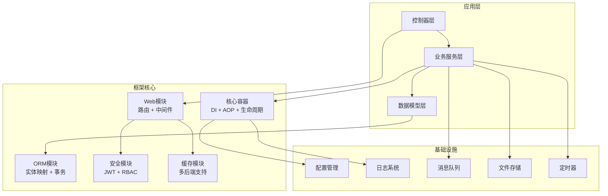
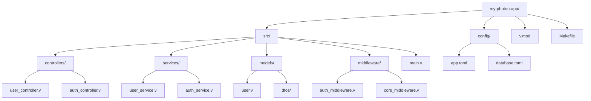
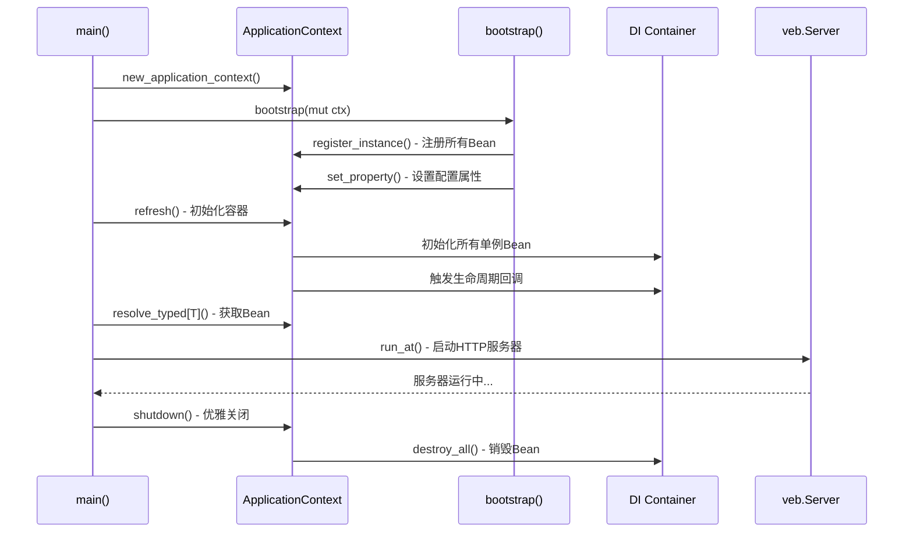

# 快速上手

Photon框架是一个基于V语言的企业级开发框架，提供注解驱动的声明式编程模型、编译期依赖注入和零运行时反射开销。本指南将帮助您快速搭建第一个Photon Web应用。

## 框架架构概览

Photon框架采用分层架构设计，核心思想是"编译期优于运行期，显式优于隐式，约定优于配置"。



图：Photon框架整体架构（类型：架构图）

## 环境准备

### V语言安装

Photon框架需要V 0.5.2 或更高版本。请按照以下步骤安装V语言：

```bash
# 克隆V语言仓库
git clone https://github.com/vlang/v.git
cd v

# 编译并安装
make

# 验证安装
v -V
```

### 系统要求

- **操作系统**：Linux、macOS、Windows（WSL推荐）
- **编译器**：GCC或Clang
- **内存**：建议至少2GB可用内存
- **磁盘空间**：至少500MB

### 验证环境

创建一个简单的测试文件验证V语言环境：

```v
// test.v
fn main() {
    println('Hello V Language!')
}
```

运行测试：
```bash
v -enable-globals -check test.v
```

如果输出"Hello V Language!"，说明环境配置正确。

## 项目创建

### 方式一：使用示例项目

最快速的方式是基于Photon的示例项目开始：

```bash
# 克隆Photon框架
git clone https://github.com/photon-framework/photon.git
cd photon

# 运行示例应用
v -enable-globals run example/   # 也可直接跑单文件：v -enable-globals run example/main.v
```

### 方式二：创建新项目

创建一个新的Photon项目目录结构：

```bash
mkdir my-photon-app
cd my-photon-app

# 创建基本目录结构
mkdir -p src/{controllers,services,models,middleware}
mkdir config
```

创建项目配置文件 `v.mod`：

```v
Module {
    name: 'my-photon-app'
    description: 'My Photon Application'
    version: '1.0.0'
    license: 'MIT'
    dependencies: [
        'photon'
    ]
}
```

### 项目结构说明



图：Photon项目目录结构（类型：结构图）

标准Photon项目包含以下核心目录：

- **src/controllers/** - Web控制器，处理HTTP请求和响应
- **src/services/** - 业务逻辑层，实现核心业务功能
- **src/models/** - 数据模型，定义实体和数据传输对象
- **src/middleware/** - 中间件，处理横切关注点（认证、日志等）
- **config/** - 配置文件，包括应用配置、数据库配置等
- **v.mod** - V语言模块配置文件，定义项目依赖和元数据
- **Makefile** - 构建脚本，简化编译和部署流程

## 基本配置

### 应用启动流程

Photon应用的启动流程遵循标准的Spring Boot模式，通过DI容器管理所有组件的生命周期。



图：Photon应用启动流程（类型：时序图）

### 应用入口文件

当前示例是「单文件入口 + 按职责拆分的 app 模块」。入口不需要任何业务代码：

```v
// main.v
module main
import app

fn main() {
	app.run()
}
```

业务放在 `app/` 子模块中（见仓库 `example/app/`）：

```v
// app/server.v（节选）
module app

import photon.core
import photon.web
import veb
import app.controllers
import app.http

// 直接嵌入 veb.Context 的别名；不要再包一层 struct
pub type Context = web.RouterContext

pub fn run() {
	mut ctx := core.new_application_context()
	ctx.register_instance('UserService', voidptr(user_service))!
	ctx.register_instance('Logger', voidptr(logger))!
	ctx.refresh()!

	mut web_app := &App{ web_module: web.init_web_module() }
	ctx.autowire_controller[App](web_app) or { panic(err) }

	// 创建 + @[autowired] 注入 + 路由挂载一步完成
	web_app.web_module.wire_and_mount[controllers.HomeController, http.Context](mut ctx) or { panic(err) }

	veb.run_at[App, http.Context](mut web_app, host: '0.0.0.0', port: 8080) or { panic(err) }
	ctx.shutdown()
}
```

控制器只写路由注解和 `@[autowired]` 字段，没有手写构造函数：

```v
// app/controllers/home_controller.v（节选）
@[controller]
pub struct HomeController {
	user_service &services.UserService = unsafe { nil } @[autowired]
}

@[get: '/']
pub fn (c &HomeController) index(mut ctx http.Context) veb.Result {
	return ctx.text('users: ${c.user_service.count()}')
}
```

### 构建脚本

创建 `Makefile` 简化构建过程：

```makefile
VFLAGS := -enable-globals

.PHONY: build run clean

build:
	@mkdir -p bin
	v $(VFLAGS) -o bin/my-app src/

run:
	v $(VFLAGS) run src/

clean:
	rm -rf bin/

help:
	@echo "Available targets:"
	@echo "  build  - Compile the application"
	@echo "  run    - Run the application"
	@echo "  clean  - Remove build artifacts"
```

## 第一个Web应用

### 创建控制器

创建 `src/controllers/user_controller.v`：

```v
module main

import veb
import photon.web

// Context 直接嵌入 veb.Context；不要再包一层 struct
pub type Context = web.RouterContext

@[controller]
pub struct UserController {
	// 业务依赖由容器注入，控制器不自己构造
	user_service &UserService = unsafe { nil } @[autowired]
}

@[get: '/api/users']
pub fn (c &UserController) list(mut ctx Context) veb.Result {
	return ctx.json({ 'users': c.user_service.list() })
}

@[get: '/api/users/:id']
pub fn (c &UserController) show(mut ctx Context) veb.Result {
	id := ctx.path_int('id') or { return ctx.json_error(400, 'invalid id') }
	user := c.user_service.get_by_id(id) or { return ctx.json_error(404, err.msg()) }
	return ctx.json_response(200, '${user}')
}

@[post: '/api/users']
pub fn (mut c UserController) create(mut ctx Context) veb.Result {
	name := ctx.form['name'] or { '' }
	email := ctx.form['email'] or { '' }
	if name.len == 0 || email.len == 0 {
		return ctx.json_error(400, 'name and email are required')
	}
	return ctx.json_response(201, '{"created":true}')
}
```

### 创建数据模型

创建 `src/models/user.v`：

```v
module main

// 用户实体
pub struct User {
pub:
    id    int
    name  string
    email string
}

// 创建用户请求
pub struct CreateUserRequest {
    name  string @[required]
    email string @[required]
}

// 用户响应
pub struct UserResponse {
    id    int
    name  string
    email string
}
```

### 创建服务层

创建 `src/services/user_service.v`：

```v
module main

import photon.core

@[service]
pub struct UserService {
pub mut:
    users []User
}

pub fn new_user_service() &UserService {
    return &UserService{
        users: [
            User{id: 1, name: 'Alice', email: 'alice@example.com'},
            User{id: 2, name: 'Bob', email: 'bob@example.com'}
        ]
    }
}

// 获取所有用户
pub fn (s &UserService) get_all() []User {
    return s.users
}

// 根据ID获取用户
pub fn (s &UserService) get_by_id(id int) !User {
    for user in s.users {
        if user.id == id {
            return user
        }
    }
    return error('User not found')
}

// 创建用户
pub fn (mut s UserService) create(req CreateUserRequest) !User {
    new_user := User{
        id: s.users.len + 1
        name: req.name
        email: req.email
    }
    s.users << new_user
    return new_user
}
```

### 更新主应用

当前示例把入口与装配分开：`main.v` 只调用 `app.run()`，业务代码在 `app/` 子模块。
控制器用 `@[autowired]` 注入服务，路由注解直接写在控制器方法上：

```v
// app/controllers/user_controller.v（节选）
@[controller]
pub struct UserController {
	user_service &services.UserService = unsafe { nil } @[autowired]
}

@[get: '/api/users/:id']
pub fn (c &UserController) show(mut ctx http.Context) veb.Result {
	id := ctx.path_int('id') or { return ctx.json_error(400, 'invalid id') }
	user := c.user_service.get_by_id(id) or { return ctx.json_error(404, err.msg()) }
	return ctx.json_response(200, '${user}')
}
```

`app/server.v` 注册 Bean、`refresh()`、给 App 注入自身依赖，然后一步创建 + 注入 + 挂载控制器：

```v
mut ctx := core.new_application_context()
ctx.register_instance('UserService', voidptr(user_service))!
ctx.register_instance('Logger', voidptr(logger))!
ctx.refresh()!

mut web_app := &App{ web_module: web.init_web_module() }
ctx.autowire_controller[App](web_app) or { panic(err) }
web_app.web_module.wire_and_mount[controllers.UserController, http.Context](mut ctx) or { panic(err) }

veb.run_at[App, http.Context](mut web_app, host: '0.0.0.0', port: 8080) or { panic(err) }
ctx.shutdown()
```

完整装配代码见仓库 `example/app/`（其中 `App.mount_controllers()` 是控制器清单）。

## 运行和测试

### 启动应用

```bash
# 使用Makefile
make run

# 或直接使用V命令
v -enable-globals run src/
```

应用启动后，访问 http://localhost:8080 查看首页。

### API测试

使用curl测试API端点：

```bash
# 获取首页
curl http://localhost:8080/

# 获取用户列表
curl http://localhost:8080/api/users

# 获取单个用户
curl http://localhost:8080/api/users/1

# 创建用户
curl -X POST http://localhost:8080/api/users \
  -H "Content-Type: application/x-www-form-urlencoded" \
  -d "name=Charlie&email=charlie@example.com"
```

### 构建生产版本

```bash
# 编译优化版本
make build

# 运行编译后的二进制文件
./bin/my-app
```

## 下一步

现在您已经成功创建了第一个Photon Web应用！接下来可以：

1. **学习依赖注入**：深入了解Photon的DI容器和注解驱动编程
2. **添加数据库支持**：集成ORM模块进行数据持久化
3. **实现认证授权**：使用安全模块添加JWT认证
4. **添加缓存**：使用缓存模块提升性能
5. **部署应用**：学习如何将应用部署到生产环境

更多详细信息请参考：
- [Photon框架文档](https://github.com/photon-framework/photon)
- [示例项目](https://github.com/photon-framework/photon/tree/master/example)

## 常见问题

### Q: V语言编译失败怎么办？
A: 确保使用V 0.5.2 或更高版本，并正确安装了GCC或Clang编译器。

### Q: 如何添加第三方依赖？
A: 在`v.mod`文件的`dependencies`数组中添加依赖项。

### Q: 如何调试应用？
A: 使用`v -g run src/`启用调试模式，或在代码中添加`println()`语句。

### Q: 如何处理静态文件？
A: 在控制器中添加静态文件路由，或使用veb的静态文件服务功能。

## 参考文献

[^1]: [Photon框架主文档](README.md#L1-L1)
[^2]: [示例应用入口文件](example/main.v#L1-L1)
[^3]: [应用初始化和Bean注册](example/app/bootstrap/bootstrap.v#L1-L1)
[^4]: [Web控制器实现](example/app/controllers/#)
[^5]: [业务服务层实现](example/app/services/services.v#L1-L1)
[^6]: [数据模型定义](example/app/models/models.v#L1-L1)
[^7]: [中间件实现](example/app/middleware/middleware.v#L1-L1)
[^8]: [核心容器实现](core/core.v#L1-L100)
[^9]: [Web模块概述](web/web.v#L1-L1)
[^10]: [项目模块配置](v.mod#L1-L1)
[^11]: [构建自动化脚本](Makefile#L1-L1)